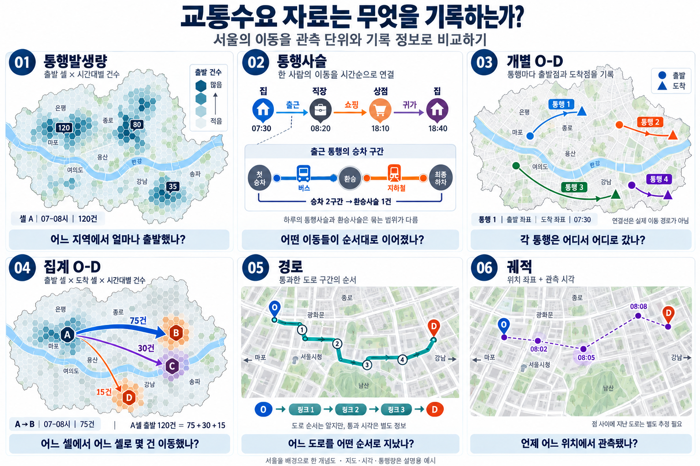
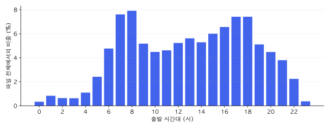
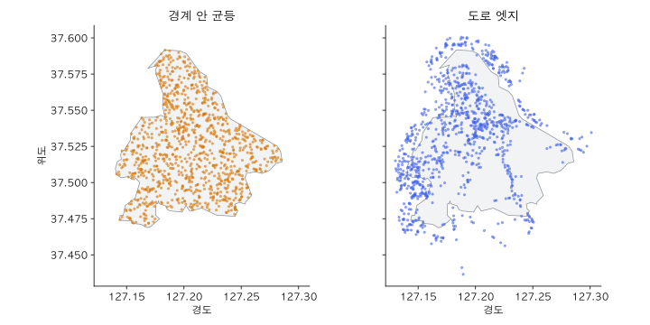
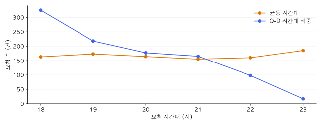
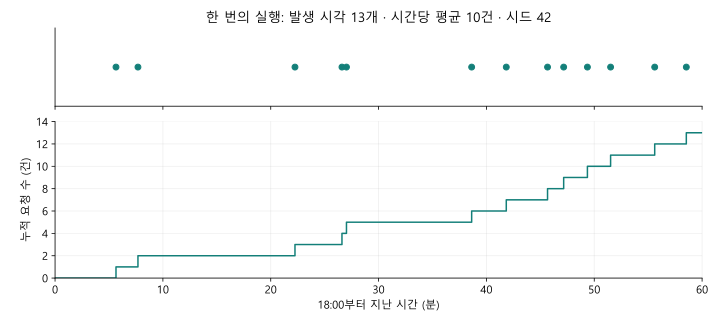
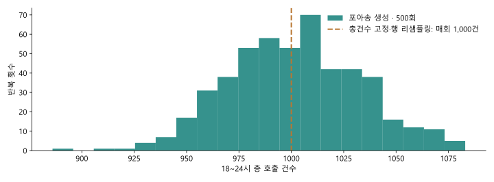

# 8장 통행 수요와 수요 생성기

통행 수요는 사람들이 언제, 어디서 어디로 얼마나 이동하려 하는지를 나타냅니다.
시뮬레이션에서는 이 수요를 입력으로 삼아 차량 대수와 배차 방식에 따른 승객 대기시간을 비교합니다.

수요를 관찰하는 자료에는 스마트카드 이용 이력, 통신사 집계표, 택시 승하차 기록, GPS 궤적이 있습니다.
자료마다 한 행이 나타내는 관측 단위가 다릅니다. 승차 한 번일 수도 있고, 수십 명을 합친 이동량이나 위치 점 하나일 수도 있습니다.
이 장에서는 자료가 담고 있는 정보에서 출발해 시뮬레이터가 받을 요청 목록을 만듭니다.
O-D가 있으면 그 분포를 읽고, 발생량만 있으면 구역 사이 통행량을 추정합니다.
그다음 개별 요청의 위치와 호출 시각을 정하고, 수요를 반복 생성해 서비스 성능을 비교합니다.

## 학습 목표

- 발생량·통행사슬·O-D·경로·궤적이 담는 정보와 관측 단위를 구분합니다.
- 발생량과 이동 저항으로 O-D를 추정하고, 출발·도착 총량을 확인합니다.
- 하남 O-D 예제의 시간대별 비중과 목적지 분포를 계산합니다.
- 위치와 호출 시각을 정하는 조건에 따라 생성 수요가 어떻게 달라지는지 비교합니다.
- 총건수 고정·부트스트랩 리샘플링·포아송 발생의 평균과 변동을 비교합니다.

## 8.1 통행 수요를 표현하는 데이터

교통수요 자료를 읽을 때는 먼저 한 행이 무엇을 나타내는지 확인합니다.
한 번의 통행, 승차 구간, 위치 점, 여러 통행을 합친 집계량은 서로 다른 **관측 단위**입니다.
출발 구역별 발생량이나 전체 요청 수만 있고 목적지 정보가 없는 자료도 있습니다.
같은 이동도 어떤 정보를 남기느냐에 따라 통행사슬, O-D, 경로, 궤적으로 표현할 수 있습니다.

**통행**(trip)은 한 장소에서 다른 장소로 이동하는 것입니다.
집에서 직장까지 버스와 지하철을 갈아타고 이동한다면, 전체 통행 안에 두 승차 구간이 있습니다.
승차 구간을 셀 때는 두 건이지만 처음 출발지에서 최종 목적지까지의 통행은 한 건입니다.

**통행사슬**(trip chain)은 한 사람의 통행이나 이동 구간을 순서대로 연결한 것입니다.
집 → 직장 → 상점 → 집처럼 활동 장소 사이의 연속된 통행을 나타낼 수 있습니다.
스마트카드에서는 환승한 승차 구간들을 연결해 한 번의 이동을 구성하기도 합니다.
이 절의 스마트카드 예제에서 통행사슬은 첫 승차부터 마지막 하차까지 환승으로 연결한 구간 묶음을 뜻합니다.
어느 범위를 하나의 사슬로 묶었는지 알아야 통행사슬 수를 비교할 수 있습니다.

**출발지-목적지**(O-D, origin–destination)는 이동의 양 끝을 나타냅니다.
개별 O-D 자료는 통행마다 출발지와 목적지를 기록합니다.
집계 O-D 자료는 같은 출발 구역과 도착 구역 사이의 통행량을 묶어 기록합니다.
개별 O-D 한 행은 통행 한 건이지만, 집계 O-D 한 행은 여러 통행을 나타낼 수 있습니다.
O-D만으로는 중간에 어느 도로를 지났는지 알 수 없습니다.

**경로**(path)는 출발지에서 목적지까지 거치는 노드나 도로 구간의 순서입니다.
같은 O-D라도 어느 교차로와 도로를 거치는지에 따라 경로가 달라집니다.
경로에 통과 시각까지 기록되어 있지 않다면 어디를 지나는지는 알아도 언제 지났는지는 알 수 없습니다.

**궤적**(trajectory)은 시간순으로 기록한 위치 점의 모음입니다.
GPS 궤적에는 위치와 관측 시각이 함께 있으므로 이동 방향과 점 사이의 시간 간격을 읽을 수 있습니다.
다만 관측 점 사이에 실제로 어느 도로를 지났는지는 별도의 경로 추정이 필요할 수 있습니다.
GPS 점을 직선으로 연결한 그림과 도로망 위의 경로는 구분합니다.

그림 8.1은 여섯 자료 형태가 남기는 정보를 비교합니다.
출발 셀의 발생량에 목적지별 건수를 더하면 집계 O-D를 표현할 수 있습니다.
경로에서는 도로 구간의 순서를, 궤적에서는 위치 점에 붙은 관측 시각을 살펴봅니다.

그림 8.1. 교통수요 자료의 여섯 가지 표현입니다. 각 칸에서 이동을 세거나 연결하는 단위와 기록 정보를 비교합니다.
서울을 배경으로 한 설명용 그림이며, 지도·시각·통행량은 실제 관측 결과가 아닌 예시입니다.

| 자료 형태 | 한 행 또는 연결된 묶음의 뜻 | 읽을 수 있는 정보 | 그 형태만으로 알 수 없는 정보 |
| --- | --- | --- | --- |
| 통행발생량 | 구역·시간대에서 출발하는 통행의 합 | 출발 구역별 수요 규모 | 목적지와 구역 간 연결 |
| 통행사슬 | 같은 사람의 통행·승차 구간을 순서대로 연결 | 구간 순서, 환승 지점, 구간별 시각 | 승하차 사이에 지난 도로 |
| 개별 O-D | 통행 한 건의 출발지와 목적지 | 양 끝 위치, 함께 기록된 출발·도착 시각 | 중간 경로와 환승 여부 |
| 집계 O-D | 같은 구역 쌍·시간대에 속하는 통행의 합 | 구역 사이 통행량과 비중 | 개인별 위치·시각과 경로 |
| 경로 | 순서가 있는 노드·도로 구간 목록 | 중간 경유 지점과 도로 연결 | 별도로 기록하지 않은 통과 시각 |
| 궤적 | 시각이 붙은 위치 점을 시간순으로 연결 | 관측 위치, 방향, 관측 시간 간격 | 관측 사이의 정확한 도로 경로 |

통행사슬에서 첫 출발지와 마지막 목적지만 남기면 O-D를 만들 수 있습니다.
궤적에서도 통행의 시작과 끝을 구분한 뒤 양 끝 위치를 O-D로 요약할 수 있습니다.
이 과정에서는 중간 구간이나 위치 점의 정보가 줄어듭니다.
반대로 O-D만 있는 자료에서 경로나 환승 구간을 만들려면 추가 자료 또는 모형 가정이 필요합니다.

다음 예제에서는 스마트카드의 환승 연결, 통신사의 집계 O-D, 택시의 개별 O-D, GPS 궤적을 비교합니다.
자료의 이름만으로 한 행의 뜻이 정해지는 것은 아닙니다.
같은 스마트카드 이용 이력도 승차별 한 행으로 저장하거나, 환승 구간을 한 행에 모아 저장할 수 있습니다.

> 아래 표는 자료 형태를 설명하기 위해 만든 교육용 예제입니다.
> 실제 이용자의 기록이 아니며, 표에 적힌 값과 조건으로 계산합니다.

### 8.1.1 스마트카드의 승차 구간과 환승 연결

스마트카드 자료는 승차·하차 시각을 정류장 또는 역 ID와 연결합니다.
환승 연결표는 같은 이동에 속한 승차 구간을 연결번호와 구간 순서로 묶습니다.
한 행에 구간별 컬럼을 나란히 둘 수도 있고, 한 행에 한 구간을 두고 연결번호를 반복할 수도 있습니다.
첫 구간에는 `승차일시1`·`하차일시1`, 다음 구간에는 `승차일시2`·`하차일시2`가 붙습니다.
정류장 ID로 위치를 알아내려면 정류장 좌표표와 연결합니다.

교육용 예제의 통행사슬 세 개를 구간별로 펼치면 다음과 같습니다.
연결번호 A·B·C와 정류장 S1~S4는 가상이며, 각 통행사슬의 이용객 수는 한 명으로 둡니다.

| 연결번호 | 구간 | 승차 → 하차 정류장 | 승차 → 하차 시각 |
| -------- | ---: | ------------------- | ----------------- |
| A        |    1 | S1 → S2            | 08:00 → 08:10    |
| A        |    2 | S2 → S3            | 08:15 → 08:35    |
| B        |    1 | S1 → S3            | 08:05 → 08:30    |
| C        |    1 | S4 → S2            | 09:00 → 09:12    |

A는 두 번 승차했지만 S1에서 S3으로 이어지는 통행사슬은 하나입니다.
그래서 이 표의 승차는 네 건이고 통행사슬은 세 개입니다.
A의 첫 승차부터 마지막 하차까지는 35분이며, 차량 안에서 보낸 30분과 환승에 소요된 5분으로 나뉩니다.
정류장에 오기 전의 이동과 마지막 하차 뒤의 이동은 이 표에 없습니다.

버스 노선의 탑승 수요를 구할 때는 구간별 승차를 셉니다.
O-D 수요를 만들 때는 연결된 첫 승차와 마지막 하차를 사용할 수 있습니다.
다만 이 O-D의 양 끝은 집이나 직장 주소가 아니라 정류장입니다.
하차 기록이 빠진 구간은 목적지를 바로 정할 수 없습니다.

### 8.1.2 통신사의 집계 O-D와 전수화 통행량

통신사 자료는 위치 관측으로 이동을 추정하고, 공간·시간 구간별로 묶어 제공합니다.
집계 O-D의 한 행은 출발 구역·도착 구역·시간대와 그 조건에 해당하는 통행량으로 구성됩니다.
같은 격자 쌍도 출발·도착 시간대, 성연령, 이동 목적에 따라 다른 행으로 나뉩니다.
`MOVE_CNT`는 관측 표본을 전체 규모로 환산한 **전수화 통행량**이어서 소수가 나올 수 있습니다.

다른 집계 조건을 같게 둔 교육용 표를 보겠습니다.

| 출발 격자`O_ID` | 도착 격자`D_ID` | 출발 시간대`O_TIME_CD` | 통행량`MOVE_CNT` |
| ----------------- | ----------------- | ------------------------ | -----------------: |
| A                 | B                 | 08                       |               12.5 |
| A                 | C                 | 08                       |                7.5 |
| A                 | B                 | 09                       |                5.0 |
| C                 | A                 | 09                       |               15.0 |

08시대 통행량은 12.5 + 7.5 = 20.0입니다. 09시대도 5.0 + 15.0 = 20.0입니다.
행은 네 개이지만 통행량 합계는 40.0입니다. 행 수를 세면 집계 조합 수를 구하게 됩니다.
12.5를 곧바로 승객 12명으로 바꾸면 행마다 반올림 오차가 쌓입니다.
먼저 분석 범위의 총량을 정하고, 각 O-D의 비중을 요청 생성 확률로 사용하는 방법을 생각할 수 있습니다.

격자 A에서 출발했다는 정보만으로는 A 안의 어느 건물에서 몇 분에 출발했는지 알 수 없습니다.
그 위치와 시각은 수요를 만들 때 추가하는 가정입니다.
한 통행을 한 승객의 요청으로 보고 동승과 취소를 제외한다고 가정합니다.
이때 전체 통행량에 택시 이용 비율을 곱해 모의 택시 요청 수를 설정할 수 있습니다.
관측된 택시 통행량에는 미배차로 끝난 호출이 빠져 있으므로, 이를 포함할 때는 미배차 비율로 보정합니다.

### 8.1.3 택시의 승하차 기록과 호출 시각

택시 승하차 자료는 한 행에 한 번의 승차와 하차를 기록하는 개별 O-D 자료입니다.
양 끝 좌표와 시각이 있으면 차내시간과 출발·도착 분포를 구할 수 있습니다.
중간 위치 기록이 없다면 실제 주행 경로는 알 수 없습니다.
다음은 별도로 만든 승하차 네 건의 예제입니다. 모두 같은 날짜에 출발하고 도착합니다.

| 예제 번호 | 승차 시각 | 하차 시각 | 승차부터 하차까지 |
| --------- | --------- | --------- | ----------------: |
| 1         | 08:00     | 08:12     |              12분 |
| 2         | 08:30     | 08:38     |               8분 |
| 3         | 18:00     | 18:20     |              20분 |
| 4         | 18:20     | 18:35     |              15분 |

첫 행의 차내시간은 08:12 − 08:00 = 12분입니다.
08:00에 탔다고 해서 08:00에 호출했다는 뜻은 아닙니다.
07:55에 호출했다면 승차 전 대기는 5분이지만, 승하차 기록만으로는 이 5분을 알 수 없습니다.
탑승하지 못하고 취소한 요청도 완료된 승하차 표에는 없습니다.

실습에서는 승차 시각을 요청 시각으로 대신 쓰는 가정을 명시합니다.
예제 좌표의 `p_x`·`d_x`는 경도, `p_y`·`d_y`는 위도로 정의했습니다.
좌표를 해석할 때는 경도·위도인지, 평면 좌표인지와 좌표계를 확인합니다.

### 8.1.4 GPS의 위치 점과 통행 구간

GPS(Global Positioning System) 자료의 한 행은 한 시점에 관측한 위치 점입니다.
같은 이동 대상의 점들을 관측 시각순으로 연결하면 궤적이 됩니다.
예제의 `traj_uid`는 점들을 같은 궤적으로 묶는 번호이고, `t_ms`는 유닉스 기준시각부터 지난 밀리초입니다.
위도·경도는 관측 위치를 나타냅니다.

경로가 도로를 지나는 순서를 나타낸다면, 이 점 표는 언제 어디에서 위치가 관측되었는지를 나타냅니다.
관측 간격이 길면 중간에 이동한 도로와 머문 장소가 기록에서 빠질 수 있습니다.

예제 궤적 하나에서 시각을 한국 현지 시각으로 바꾸면 다음 네 점이 나옵니다.

| 궤적   | 시각  | 위도`lat` | 경도`lon` |
| ------ | ----- | ----------: | ----------: |
| 예제 1 | 08:00 |      37.540 |     127.200 |
| 예제 1 | 08:02 |      37.541 |     127.202 |
| 예제 1 | 08:05 |      37.545 |     127.210 |
| 예제 1 | 08:10 |      37.550 |     127.220 |

이 궤적을 끊김 없는 통행 하나로 가정하면 첫 점과 마지막 점이 O-D 후보가 됩니다.
관측 시간은 10분입니다. 네 행을 네 요청으로 넣으면 같은 통행을 중복하게 됩니다.
GPS 기록 간격을 더 짧게 바꾸면 점 수는 늘어도 이동한 사람 수는 늘지 않습니다.

실제 자료에서는 기록 시작 전에 이미 이동 중이었거나, 중간에 통신이 끊겼을 수 있습니다.
그래서 궤적의 첫 점과 마지막 점이 실제 출발·도착 장소인지 검토합니다.
수단별 구간을 묶는 기준에 따라 도보 접근과 차량 탑승을 별개 통행으로 셀 수도, 하나로 연결할 수도 있습니다.

[8장 실습 노트북][ch08-lab]의 1절에서 샘플 표와 그림을 함께 살펴봅니다.
환승 구간의 시간선, 집계 O-D 행렬, 택시 O-D, GPS 궤적과 가상 경로를 비교합니다.
같은 이동을 나타내더라도 남아 있는 정보가 다르다는 점을 확인합니다.

이제 이 자료들을 시뮬레이터에 넣으려면 무엇이 필요한지 살펴봅니다.
다음 절의 요청 형식에 맞춰 보면, 자료에서 바로 가져올 값과 새로 정해야 할 값이 구분됩니다.

## 8.2 시뮬레이션용 요청 목록

교재의 시뮬레이터는 한 행이 요청 하나인 표를 받습니다.
한 요청을 한 승객으로 다루며, 호출 시각과 양 끝 좌표를 다섯 컬럼으로 기록합니다.

| 컬럼             | 뜻                 | 표현 방식        |
| ---------------- | ------------------ | ---------------- |
| `request_time` | 요청이 발생한 시각 | 자정부터 지난 분 |
| `origin_lat`   | 출발지 위도        | WGS84, 도        |
| `origin_lon`   | 출발지 경도        | WGS84, 도        |
| `dest_lat`     | 목적지 위도        | WGS84, 도        |
| `dest_lon`     | 목적지 경도        | WGS84, 도        |

18:20의 요청 시각은 18 × 60 + 20 = 1100입니다.
8.1.3절 택시 예제의 네 번째 요청에 다음과 같은 예제 좌표를 부여합니다.
출발지는 (위도 37.560, 경도 127.230), 목적지는 (위도 37.540, 경도 127.200)입니다.
승차 시각을 요청 시각으로 대신 쓰면 `request_time`은 1100입니다.

자료마다 이 표에 이르는 과정이 다릅니다.
스마트카드는 정류장 좌표를 연결합니다.
통신사 집계표에서는 요청 수를 설정하고 구역 안에서 위치를 뽑습니다.
택시는 시각과 좌표 단위를 맞추며, GPS는 먼저 통행 경계를 정합니다.

택시 승하차처럼 개별 O-D가 있으면 시각과 좌표를 변환해 이 형식에 가까워집니다.
집계 O-D에는 개인별 시각·위치가 없고, 발생량만 있는 자료에는 목적지 연결도 없습니다.
먼저 구역 사이의 통행량을 확인하거나 추정하고, 그다음 각 요청의 시각과 위치를 정하겠습니다.

## 8.3 O-D 분포의 확인과 추정

수요의 공간·시간 분포를 정하는 방법은 가진 자료에 따라 달라집니다.
O-D 집계표가 있으면 시간대와 구역 쌍의 비중을 계산합니다.
발생량만 있다면 목적지와 이동 저항에 관한 정보를 더해 O-D를 추정합니다.
하남 집계표로 분포를 읽는 경우를 먼저 보고, O-D가 없는 작은 예제로 이어갑니다.

### 8.3.1 하남 O-D 예제의 시간대 패턴

> 이 파일은 시간대와 목적지의 상대적 분포를 살펴보는 교육용 예제입니다.
> 집계 기간이 확인되지 않아 합계를 하루 통행량으로 해석하지 않습니다.
> 전체 통행의 분포를 택시 수요에 적용하는 것은 별도의 모형 가정입니다.

이제 한 자료의 분포를 수요 생성에 사용해 보겠습니다.
교재의 `od_2024.parquet`는 출발·도착 행정동과 출발 시간대별 통행량을 담은 83,135행 표입니다.
앞 절의 가상 격자 O-D 예제와는 다른 파일입니다.
집계 O-D의 공개 사례는 [서울 열린데이터광장의 수도권 생활이동][seoul]에서도 확인할 수 있습니다.

| 컬럼             | 뜻                | 이번 장에서의 사용               |
| ---------------- | ----------------- | -------------------------------- |
| `O_ADMDONG_CD` | 출발 행정동 코드  | 하남 출발 행 선택                |
| `D_ADMDONG_CD` | 도착 행정동 코드  | 목적지별 집계                    |
| `ST_TIME_CD`   | 출발 시간대, 0~23 | 시간대별 집계                    |
| `CNT`          | 집계 통행량       | 합계와 비중 계산                 |
| `MOVE_DIST`    | 이동거리 요약값   | 단위 재확인 전까지 계산에서 제외 |
| `MOVE_TIME`    | 이동시간 요약값   | 단위 재확인 전까지 계산에서 제외 |

그림 8.2는 파일의 모든 행을 시간대별로 묶어 `CNT`를 더한 결과입니다.
분모는 파일 전체의 `CNT` 합계 830,546.59입니다.

그림 8.2. 하남 O-D 예제의 24개 시간대 비중입니다. 08시와 17~18시의 봉우리 높이를 비교합니다.

| 출발 시간대 | `CNT` 합계 | 파일 전체에서 차지하는 비중 |
| ----------- | -----------: | --------------------------: |
| 00시        |     2,786.25 |                       0.34% |
| 03시        |     5,206.23 |                       0.63% |
| 08시        |    65,687.93 |                       7.91% |
| 17시        |    61,572.55 |                       7.41% |
| 18시        |    61,572.53 |                       7.41% |
| 23시        |     3,061.33 |                       0.37% |

이 파일에서는 08시대가 가장 높고 00시대가 가장 낮습니다.
08시와 17~18시의 봉우리는 출퇴근 시간대와 겹칩니다.
그러나 목적 컬럼이 없으므로 이 통행이 모두 출퇴근이라고 단정할 수는 없습니다.
03시대와 08시대의 비중은 약 12.6배 차이가 납니다.

### 8.3.2 하남 출발 통행의 목적지 분포

시간대 비중을 계산할 때는 하남으로 들어오는 행과 하남에서 나가는 행을 모두 사용했습니다.
이번에는 출발지가 하남인 행만 남깁니다.
이 파일의 행정동 코드는 여덟 자리이며, 앞 다섯 자리로 시군구를 구분합니다.
하남의 시군구 코드는 41450입니다.

하남 출발 행의 `CNT` 합계는 571,369.27이고, 목적지도 하남인 합계는 308,001.90입니다.
내부 통행 비중은 308,001.90 ÷ 571,369.27 = 53.9%입니다.
출발 행정동은 14개입니다.

| 목적지   | 하남 출발 행의`CNT` 합계 | 하남 출발 전체에서의 비중 |
| -------- | -------------------------: | ------------------------: |
| 하남시   |                 308,001.90 |                     53.9% |
| 강동구   |                  54,218.65 |                      9.5% |
| 송파구   |                  41,810.67 |                      7.3% |
| 강남구   |                  17,923.09 |                      3.1% |
| 남양주시 |                  17,332.75 |                      3.0% |

하남시 경계 안만 모델링하면 하남에서 출발해 경계 밖으로 나가는 46.1%는 다루지 못합니다.
이 통행을 모두 삭제할지, 외부 출입 지점을 둘지, 도로망 범위를 넓힐지는 분석 질문에 따라 정합니다.
하남 밖 통행을 전부 서울 동남권으로 묶을 수도 없습니다. 남양주시처럼 다른 방향의 목적지도 있습니다.

### 8.3.3 통행발생량에서 O-D 추정

어느 구역에서 출발하는 통행이 몇 건인지만 아는 경우도 있습니다.
이때 **통행발생량**은 출발 구역별 통행의 합이며, 어느 목적지로 가는지는 아직 정해지지 않았습니다.
도착 구역별 통행량까지 알아도 두 구역 사이의 연결은 하나로 정해지지 않습니다.
출발·도착 총량을 구역 간 통행량으로 나누는 단계를 **통행분포**(trip distribution)라고 합니다.
여기서는 한 분석 시간대의 실제 출발 방향과 도착 방향을 기준으로 계산합니다.

예를 들어 출발 구역 O1에서 60건, O2에서 40건이 발생하고, 도착 구역 D1과 D2에 각각 50건이 도착한다고 가정합니다.
O1 → D1이 50건인 경우와 30건인 경우 모두 이 총량에 맞는 O-D 행렬을 만들 수 있습니다.
따라서 출발·도착 총량만으로는 어느 O-D 행렬이 실제 이동에 가까운지 판단할 수 없습니다.
전체 100건이라는 총량만 있다면, 출발 구역별 비중을 정하는 가정도 먼저 필요합니다.

**중력모형**(gravity model)은 목적지의 규모와 구역 사이의 이동 저항으로 통행량을 배분합니다.
목적지의 규모가 클수록, 이동시간이나 거리가 짧을수록 더 많은 통행을 배분하는 방식입니다.
[FHWA의 통행분포 설명][gravity]에서도 목적지 규모와 이동시간을 중력모형의 입력으로 설명합니다.
출발지별 발생량을 먼저 맞추는 모형은 다음과 같이 쓸 수 있습니다.

$$
T_{ij}=O_i\frac{A_j f(c_{ij})}{\sum_k A_k f(c_{ik})}
$$

$O_i$는 출발 구역 $i$의 발생량이고, $A_j$는 목적지 $j$의 매력도를 나타내는 가중치입니다.
일자리 수나 시설 규모, 도착량 추정치 등을 목적지 가중치로 사용할 수 있습니다.
$c_{ij}$는 구역 사이의 이동시간 또는 거리이고, $f$는 이동 저항이 커질수록 작아지는 함수입니다.
$T_{ij}$는 모형이 추정한 O-D 통행량입니다. 각 행을 더하면 출발량 $O_i$가 됩니다.

작은 예제에서 D1과 D2의 가중치를 모두 50으로 두고, $f(c)=1/c^2$를 사용해 봅시다.
이동시간은 양수인 분 단위 값이며, 제곱에 반비례한다는 조건은 설명을 위한 가정입니다.

| 출발지 | 목적지 | 이동시간(분) | 출발량만 맞춘 추정 통행량 |
| --- | --- | ---: | ---: |
| O1 | D1 | 10 | 48 |
| O1 | D2 | 20 | 12 |
| O2 | D1 | 20 | 8 |
| O2 | D2 | 10 | 32 |

O1에서 D1과 D2로 갈 가중치는 각각 $50/10^2=0.5$, $50/20^2=0.125$입니다.
두 값의 비율이 4:1이므로 O1의 60건을 48건과 12건으로 나눕니다.
같은 계산으로 O2의 40건은 8건과 32건이 됩니다.
출발량은 60건과 40건으로 맞지만, 도착량은 56건과 44건이 됩니다.
목적지 가중치로 50을 사용했다고 해서 도착량이 각각 50건으로 고정되는 것은 아닙니다.

도착량도 각각 50건으로 맞추려면 행 합과 열 합을 함께 제약해야 합니다.
실습에서는 각 열을 목표 도착량에 맞게 비례 조정하고, 각 행을 목표 출발량에 맞게 다시 조정합니다.
행과 열의 오차가 충분히 작아질 때까지 반복하면 두 총량을 모두 만족하는 행렬을 얻습니다.
이 예제는 모든 구역 쌍이 연결되어 있고 출발량 합과 도착량 합이 모두 100건인 조건입니다.

추정 O-D는 관측된 이동 기록과 구분합니다.
같은 출발·도착 총량이라도 이동시간과 저항함수를 바꾸면 구역 사이의 배분은 달라집니다.
추정한 각 O-D의 비중으로 구역 쌍을 뽑은 뒤, 구역 안의 위치와 호출 시각을 정하면 개별 요청을 만들 수 있습니다.
소수인 추정량을 확률로 사용해 요청을 뽑을 때는 표집 결과가 추정량과 정확히 같지는 않습니다.

여기까지 얻은 것은 시간대와 구역 사이의 통행량 또는 그 비중입니다.
이 비중을 개별 요청으로 바꾸려면 구역 안의 위치와 분 단위 호출 시각을 정해야 합니다.
다음 절에서는 요청 수를 1,000건으로 고정하고, 위치와 시각을 정하는 조건을 하나씩 바꿉니다.

## 8.4 개별 요청의 위치와 호출 시각 생성

이제 8.2절의 요청 목록을 만듭니다.
요청 수는 1,000건, 시간 범위는 18:00~24:00로 두고 위치 조건부터 비교합니다.
경계 내부에서 위치를 뽑은 결과와 도로 구간에서 뽑은 결과를 본 뒤, 같은 도로 조건에서 시간대 비중을 바꿉니다.
이 기본 예제는 위치 생성 원리를 살펴보기 위해 출발지와 목적지를 따로 뽑습니다.
앞 절에서 추정한 O-D를 반영하는 경우에는 구역 쌍을 먼저 뽑고 각 구역 안에서 위치를 정합니다.

### 8.4.1 경계 내부의 위치 생성

개인별 출발·도착 위치가 없을 때는 행정구역 경계 안에서 위치를 뽑을 수 있습니다.
경계 안의 같은 면적이 같은 선택 확률을 갖게 하는 방법을 **균등 표집**이라고 합니다.
출발지와 목적지는 따로 뽑습니다.
지나치게 짧은 요청을 제외하기 위해 두 점의 직선거리가 0.5km 이상인 쌍만 사용합니다.
이 기준은 실습을 위한 설정입니다.

그림 8.3의 왼쪽은 하남 경계 안에서 뽑은 요청 1,000건의 출발지입니다.
난수 시드는 42이고 시각 범위는 18:00 이상, 24:00 미만입니다.
산지나 하천도 경계 안에 있으면 위치 후보가 됩니다.
면적을 고르게 채우는 조건에는 토지 이용이나 차량 접근성 정보가 없기 때문입니다.

그림 8.3. 같은 요청 수와 시드로 생성한 출발지입니다. 왼쪽은 경계 내부, 오른쪽은 도로 엣지에서 위치를 뽑았습니다.

### 8.4.2 도로 구간에서의 위치 생성

도로망의 엣지는 두 노드를 연결하는 도로 구간입니다.
그림 8.3의 오른쪽은 자동차 도로망의 엣지를 골라 위치를 뽑은 결과입니다.
교재 생성기는 엣지 양 끝의 직선거리에 비례해 엣지를 선택합니다.
길이가 100m인 엣지와 300m인 엣지만 있다면 선택 확률은 각각 25%, 75%입니다.
이 실습에서는 도로 구간을 양 끝점 사이의 직선으로 단순화하고, 그 선분 위에서 위치를 고르게 뽑습니다.
굽은 도로에서는 생성 위치가 실제 도로 중심선과 어긋날 수 있습니다.

도로 엣지를 사용하면 위치 후보가 도로망을 따릅니다.
사용한 도로망에는 경계 밖의 엣지도 있어 일부 출발지가 경계 바깥에 놓입니다.
승하차 가능한 도로인지는 구분하지 않습니다.
주택가의 짧은 도로보다 자동차 전용도로의 긴 엣지가 더 자주 선택될 수도 있습니다.

출발지와 목적지는 거리 조건을 적용하기 전까지 독립적으로 뽑습니다.
그래서 8.3.2절에서 본 행정동 간 O-D 관계는 아직 들어 있지 않습니다.
공간 분포를 더 반영하려면 O-D 쌍을 먼저 선택하고 각 구역 안의 위치를 뽑는 순서가 필요합니다.

### 8.4.3 시간대별 비중에 따른 호출 시각 생성

출발지와 목적지가 같아도 언제 요청하느냐에 따라 이용할 수 있는 차량이 달라집니다.
요청이 시간에 걸쳐 고르게 들어오면 한 차량이 여러 승객을 차례로 태울 수 있습니다.
반면 짧은 시간에 요청이 몰리면 앞선 승객을 태운 차량이 돌아오기 전에 다음 요청이 들어옵니다.
호출 시각은 각 요청이 차량을 기다리기 시작하는 시점을 정합니다.

이 실험에서는 전체 요청 수를 같게 두고, 호출이 발생하는 시간 분포를 바꿉니다.
먼저 실험 시간 동안 요청이 고르게 발생하는 경우를 기준으로 둡니다.
다음으로 하남 O-D 자료에서 통행이 많은 시간대에 요청도 더 많이 발생하도록 만듭니다.
두 조건을 비교하면 요청 총량이 같아도 특정 시간대에 몰리는 정도가 서비스에 어떤 영향을 주는지 살펴볼 수 있습니다.

집계표에는 시간대별 통행량이 있지만, 각 승객이 몇 분에 요청했는지는 없습니다.
그래서 개별 요청마다 시간대를 하나 고르고, 그 시간대 안에서 호출 시각을 정합니다.
시간대는 집계 통행량의 비중에 따라 고릅니다. 통행량이 큰 시간대일수록 더 자주 선택됩니다.
선택한 시간대 안에서는 분 단위 시각을 고르게 뽑습니다.
이는 집계표에 없는 세부 시각을 채우기 위해 한 시간 안에서는 발생률이 일정하다고 가정한 것입니다.

저녁만 실험한다면 저녁 시간대에 해당하는 통행량끼리 비교해 비중을 구합니다.
하루 전체에서 저녁이 차지하는 비중이 아니라, 저녁 요청이 각 시간대에 어떻게 나뉘는지가 필요하기 때문입니다.
비중 계산과 호출 시각 생성은 실습 노트북 4.3절에서 확인합니다.

그림 8.4. 도로망·요청 수 1,000건·시드 42를 고정하고 시각 분포를 바꾼 결과입니다. 원자료 비중을 쓴 경우에도 표집 오차가 남습니다.

그림 8.4의 두 조건은 요청 총량이 같습니다. 하지만 차량이 부족해질 시간대는 달라질 수 있습니다.
두 조건의 위치는 모두 엣지 양 끝의 직선거리에 비례해 뽑습니다.

이 조건으로 요청 목록 하나를 만들었습니다.
운영안을 비교할 때는 이 목록에서만 결과가 좋은지, 수요를 다시 만들어도 비슷한지 확인해야 합니다.
다음 절에서는 무엇을 고정하고 무엇을 무작위로 바꿀지 정합니다.

## 8.5 수요의 반복 생성과 변동

앞 절에서 만든 요청 1,000건으로 서비스율을 계산했다고 해 봅시다.
다른 요청 1,000건을 넣어도 비슷한 서비스율이 나올까요?
같은 시간대 비중과 위치 생성 규칙을 사용해도 실제로 뽑힌 요청은 달라집니다.
가까운 곳에 요청이 이어지는 목록도 있고, 먼 곳에서 요청이 동시에 발생하는 목록도 있습니다.
차량이 대응하기 쉬운 정도가 달라지므로 서비스율과 대기시간도 달라질 수 있습니다.

한 번의 결과에는 수요 조건의 영향과 우연히 뽑힌 요청 목록의 영향이 함께 들어 있습니다.
그래서 같은 조건으로 요청 목록을 다시 만들고 시뮬레이션을 반복합니다.
8.6절에서는 두 시간 분포의 성능 차이를 비교하고, 그 차이가 반복 실험에서도 나타나는지 확인합니다.
먼저 총건수를 유지한 반복을 살펴본 뒤, 총건수까지 달라지는 경우로 넓혀 봅시다.

### 8.5.1 같은 총건수로 요청 목록을 다시 만들기

매번 요청 수를 1,000건으로 유지하고 각 요청의 시각과 위치를 다시 뽑습니다.
새 목록마다 같은 차량 조건으로 시뮬레이션을 실행하면 서비스율과 대기시간의 변동을 볼 수 있습니다.
이때 고정하는 것은 전체 요청 수입니다. 개별 요청 목록 전체를 고정하는 것과는 다릅니다.
목록 전체를 고정하면 호출 시각과 출발지·목적지까지 매번 같습니다.

설명을 위해 18시대 비중이 30%, 나머지 다섯 시간의 비중 합이 70%라고 가정합니다.
각 요청이 18시대에 들어갈 확률을 0.3으로 두고 1,000번 뽑습니다.
18시대 건수의 기댓값은 $1{,}000\times0.3=300$건입니다.
실제로 뽑은 건수는 300보다 많거나 적을 수 있습니다.
그래도 여섯 시간의 건수를 더하면 언제나 1,000건입니다.

시간대별 건수를 $N_h$, 전체 건수를 $N$, 시간대 비중을 $p_h$라고 하면 다음 관계가 성립합니다.

$$
\sum_h N_h=N,\qquad E[N_h]=Np_h
$$

시간대별 건수의 묶음은 **다항분포**(multinomial distribution)를 따릅니다.
한 시간대에 요청이 더 배정되면 다른 시간대에 배정할 수 있는 요청 수가 줄어듭니다.
따라서 시간대별 건수는 서로 독립이 아닙니다.

고른 시간대 안에서는 호출 시각을 균등하게 뽑습니다.
이는 한 시간 안의 발생률이 일정하다는 가정입니다.
역에 열차가 도착한 직후처럼 짧은 시간에 호출이 몰리는 현상은 별도로 반영하지 않습니다.

### 8.5.2 전체 요청 수도 달라지게 만들기

총건수를 매번 1,000건으로 정하면, 호출이 많은 저녁과 적은 저녁의 차이는 실험에 들어가지 않습니다.
실제로는 저녁마다 요청이 정확히 1,000건씩 들어오지는 않을 것입니다.
이번에는 고정했던 총건수에도 변동을 허용합니다.
총건수 고정 실험은 요청이 1,000건이라는 조건에서 요청 구성의 영향을 확인합니다.
포아송 생성은 평균적으로 1,000건이 발생하는 조건에서 총건수까지 달라질 때의 성능을 확인합니다.
포아송 모형에서는 기대 총건수를 정하고 실제 건수를 무작위로 뽑습니다.

한 시간에 평균 10건이 발생한다고 가정해 봅시다.
평균이 10이라는 말은 매시간 정확히 10건이 발생한다는 뜻이 아닙니다.
어떤 시간에는 7건, 다른 시간에는 13건이 발생할 수 있습니다.
$N\sim\operatorname{Poisson}(10)$은 요청 건수 $N$이 평균 10인 포아송 분포를 따른다는 뜻입니다.
0건, 1건, 2건처럼 가능한 건수마다 확률이 주어지지만, 각 요청의 발생 시각은 정해지지 않습니다.

**포아송 분포**(Poisson distribution)는 정한 구간에서 발생하는 사건의 건수를 나타내는 분포입니다.
그 구간의 기대 건수를 $\mu$라고 할 때, $k$건이 발생할 확률은 다음과 같습니다.
[NIST의 분포 설명][ch08-source-2]에 확률식과 평균·표준편차가 정리되어 있습니다.

$$
P(N=k)=\frac{e^{-\mu}\mu^k}{k!},\qquad k=0,1,2,\ldots
$$

평균과 분산이 모두 $\mu$라는 점이 이 분포의 특징입니다.
기대 건수가 10건이면 표준편차는 $\sqrt{10}\approx3.16$건입니다.
기대 건수가 0이면 발생 건수도 항상 0입니다.

#### 시간에 따른 요청 발생과 포아송 과정

시뮬레이션에는 건수뿐 아니라 각 요청의 발생 시각이 필요합니다.
18:03, 18:08, 18:09, 18:21에 요청이 들어오면 누적 요청 수는 각 시각에 한 건씩 증가합니다.
이처럼 시간에 따라 사건이 발생하고 누적되는 모습을 확률적으로 나타내는 모형 중 하나가 **포아송 과정**(Poisson process)입니다.

가장 기본적인 모형은 발생률이 일정한 포아송 과정입니다.
관측 시작 시 누적 건수를 0으로 두고 다음을 가정합니다.

- 단위 시간당 평균 발생 건수가 일정합니다.
- 서로 겹치지 않는 시간 구간의 발생 건수는 독립입니다.
- 아주 짧은 구간에서는 한 건이 발생할 확률이 구간 길이에 대략 비례합니다. 두 건 이상 발생할 확률은 그보다 훨씬 작습니다.

발생률이 일정해도 요청이 일정한 간격으로 들어오지는 않습니다.
시간당 평균 10건이라고 해서 정확히 6분마다 한 건씩 발생하는 것은 아닙니다.
그림 8.5의 위쪽 점은 한 번 생성한 발생 시각이고, 아래 계단은 같은 시각까지 누적된 건수입니다.
요청 사이의 간격은 불규칙하며, 요청이 없는 동안에는 누적 건수가 그대로입니다.

그림 8.5. 시간당 평균 10건, 난수 시드 42로 생성한 한 시간의 요청입니다.
위쪽의 점 하나가 아래쪽 계단의 한 번 증가에 대응합니다. 관측자료가 아닌 모형의 생성 예제입니다.

**발생률**(arrival rate)은 단위 시간당 기대 건수입니다.
분당 발생률을 $lambda$라 하면, 관측 시작부터 $t$분까지의 누적 건수 $N(t)$는 다음 분포를 따릅니다.

$$
N(t)simoperatorname{Poisson}(lambda t)
$$

하나의 발생 과정에서 일정 구간의 건수를 세면 포아송 분포로 설명할 수 있습니다.
시간당 평균 10건이면 분당 발생률은 $10/60$건입니다.
6분 구간은 기대 건수가 1건이므로 $operatorname{Poisson}(1)$을 따릅니다.
30분 구간은 $operatorname{Poisson}(5)$, 60분 구간은 $operatorname{Poisson}(10)$을 따릅니다.
구간의 기대 건수는 발생률과 구간 길이를 곱한 값이므로 두 값의 시간 단위를 맞춥니다.

#### 건수에서 개별 요청 시각으로의 변환

발생률이 일정한 한 시간의 요청 시각은 다음 순서로 만들 수 있습니다.

1. 포아송 분포에서 그 시간의 요청 건수 $n$을 뽑습니다.
2. 그 시간 안에서 $n$개의 시각을 서로 독립적으로 균등하게 뽑습니다.
3. 뽑은 시각을 시간순으로 정렬합니다. 건수가 0이면 요청 시각도 없습니다.

왜 건수를 뽑은 뒤 시각을 균등하게 뽑을까요?
발생률이 일정한 포아송 과정에서, 한 구간에 $n$건이 발생했다고 주어졌다고 해 봅시다.
그때 발생 시각의 분포는 구간 안에서 독립적으로 균등하게 뽑은 $n$개 시각을 정렬한 분포와 같습니다.
이 성질 때문에 건수와 시각을 두 단계로 생성할 수 있습니다.
[MIT의 도착 시각 설명][ch08-source-3]에서 이 관계를 유도합니다.

다른 방법으로는 요청 사이의 간격을 지수분포에서 독립적으로 뽑아 차례로 더할 수 있습니다.
발생률이 $lambda$일 때 평균 간격은 $1/lambda$이며, 시간당 평균 10건이면 평균 간격은 6분입니다.
이 장에서는 시간대별 기대 건수를 사용하므로 건수를 먼저 뽑는 방법을 사용합니다.
그림 8.5는 연속적인 시각을 쓰고, 실습의 시뮬레이터 입력은 분 단위 정수로 만듭니다.
분 단위로 묶으면 서로 다른 요청이 같은 분에 기록될 수 있습니다.

#### 시간대별로 다른 발생률

하남 예제에서는 18시대와 23시대의 수요가 다릅니다.
각 시간대 안에서는 발생률을 일정하게 두고, 시간대가 바뀔 때 발생률을 바꿉니다.
이렇게 시간에 따라 발생률이 달라지는 모형은 비동질 포아송 과정에 해당합니다.
여섯 시간의 기대 총건수 $\mu$를 시간대별 비중 $p_h$로 나눕니다.

$$
\mu_h=\mu p_h,\qquad N_h\sim\operatorname{Poisson}(\mu_h)
$$

각 시간대의 $N_h$를 독립적으로 뽑습니다. 한 시간의 발생률은 분당 $\mu_h/60$건입니다.
그 시간 안에서는 발생률이 일정하다고 가정하고 호출 시각을 정합니다.
18시대에는 많이, 23시대에는 적게 발생하면서도 실행마다 건수가 달라집니다.

설명용 비중 $p_{18}=0.3$과 기대 총건수 $\mu=1{,}000$을 쓰면, 18시대의 기대 건수는 300건입니다.
고정 방식과 기댓값은 같지만, 이번에는 전체 건수도 달라집니다.
독립인 시간대별 포아송 건수의 합도 포아송 분포를 따릅니다.
따라서 총건수의 표준편차는 $\sqrt{1{,}000}\approx31.6$건입니다.

#### 포아송 가정의 한계

같은 요일·시간대라도 비가 오거나 행사가 끝난 직후에는 호출이 함께 늘 수 있습니다.
이런 상황에서는 실제 호출 건수의 변동이 포아송 모형이 가정한 변동보다 클 수 있습니다.

실제 자료를 적용할 때는 같은 조건의 시간대들을 모아 건수의 평균과 분산을 비교합니다.
하루 안의 서로 다른 시간대를 한꺼번에 비교하면, 시간대별 평균 차이와 무작위 변동이 섞입니다.
한 개 집계 프로파일만으로 날짜별 분산이나 독립 발생 가정이 맞는지 판단할 수는 없습니다.

### 8.5.3 실제 요청 기록을 이용해 다시 만들기

앞에서는 정한 규칙으로 요청의 시각과 위치를 만들었습니다.
실제 요청 기록이 있다면 그 내용을 활용할 수 있을까요?
총건수를 정하는 문제와 각 요청의 내용을 구성하는 문제는 나누어 생각할 수 있습니다.
총건수를 1,000건으로 고정하고 기존 행을 뽑을 수도 있습니다.
포아송 분포로 총건수를 정한 다음, 그 수만큼 기존 행을 뽑을 수도 있습니다.
행을 통째로 다시 뽑으면 한 요청 안의 시간과 O-D 관계를 함께 가져올 수 있습니다.

**복원추출**(sampling with replacement)은 한 번 뽑은 대상을 다시 뽑을 수 있게 하는 표집입니다.
다음은 원리를 설명하기 위한 가상 요청 네 건입니다.

| 기준 요청 | 호출 시각 | 출발지 → 목적지 |
| --------- | --------- | ---------------- |
| A         | 18:02     | 주거지 → 역     |
| B         | 18:10     | 역 → 주거지     |
| C         | 18:35     | 상가 → 주거지   |
| D         | 19:05     | 주거지 → 상가   |

네 행을 같은 확률로 네 번 뽑으면, 한 가능한 결과는 B, B, D, A입니다.
B는 두 번 포함되고 C는 빠집니다.
B를 뽑을 때마다 호출 시각 18:10과 역 → 주거지라는 O-D 쌍을 함께 복사합니다.
시각과 출발지·목적지를 각각 따로 뽑으면 원래 행의 관계를 잃습니다.

기존 자료에서 표본을 다시 뽑는 것을 리샘플링(resampling)이라고 합니다.
**부트스트랩**(bootstrap)은 관측 자료에서 표본을 반복해서 다시 뽑아 통계량의 변동을 추정하는 방법입니다.
이 장에서는 원자료와 같은 수의 요청 행을 복원추출해 새로운 요청 목록을 만듭니다.
[CMU의 부트스트랩 강의][ch08-source-1]에서 리샘플링과 통계적 추론의 관계를 설명합니다.

기준이 1,000건이면 이 방법으로 만든 목록도 매번 1,000건입니다.
시간대별 건수와 O-D 쌍의 구성은 달라집니다.
같은 행이 반복될 수 있으므로 원자료의 1,000개 행이 모두 한 번씩 나타나는 것은 아닙니다.

이 방법은 기준 목록에 없는 위치나 새로운 O-D 쌍을 만들지 못합니다.
행을 독립적으로 뽑으므로, 여러 요청이 연속해서 몰리는 관계도 보존하지 못합니다.
이 관계가 중요하다면 연속된 시간 구간이나 하루 전체를 묶어서 뽑는 블록 리샘플링을 검토합니다.
그때는 같은 조건에서 관측한 시간 구간이나 날짜가 충분히 있어야 합니다.

### 8.5.4 반복 실험에서 무엇을 비교할 것인가

시간 분포의 영향을 확인하려면 각 반복 안에서 두 조건의 총건수와 출발지·목적지 쌍을 같게 둡니다.
차량의 초기 위치와 운행 시간도 같게 두고, 호출 시각을 정하는 분포만 바꿉니다.
다음 반복에서는 새 요청 목록을 만들고 같은 비교를 수행합니다.
각 반복에서 두 조건의 서비스율 차이와 평균 대기시간 차이를 기록합니다.
차이의 방향이 유지되는지, 차이의 크기가 반복마다 얼마나 달라지는지 살펴봅니다.

차량 운영안을 비교하는 실험이라면 호출 시각까지 포함한 요청 목록 하나를 두 운영안에 공통으로 사용합니다.
무엇을 비교하는가에 따라 공통으로 유지할 입력과 바꿀 입력이 달라집니다.

다음 그림은 서비스 성능 비교에 앞서 총건수 자체의 변동을 확인한 예입니다.
그림 8.5가 한 번의 발생 과정을 보여 주었다면, 그림 8.6은 여러 번 뽑은 총건수의 분포를 보여 줍니다.
총건수 고정은 매번 1,000건이고, 포아송 생성은 평균을 1,000건으로 둡니다.
포아송 분포는 위치를 정해 주지 않으므로 출발지·목적지를 만드는 규칙은 별도로 정합니다.

그림 8.6. 18~24시의 기대 총건수를 1,000건으로 두고 포아송 호출 건수를 500번 뽑은 결과입니다.
시간대 비중은 저장소 O-D 집계값이며 난수 시드는 42~541입니다.
점선은 총건수 고정과 행 리샘플링에서 매번 얻는 1,000건을 표시합니다.

이 반복의 총건수 평균은 1,001.5건, 표준편차는 31.4건입니다.
이론값인 평균 1,000건과 표준편차 약 31.6건에 가깝지만, 유한한 횟수로 계산한 값이라 차이가 남습니다.

그림 8.6에서 포아송 총건수가 퍼지는 것은 설정한 모형이 만드는 변동입니다.
이 폭을 실제 하남시의 날짜별 수요 변동으로 해석할 수는 없습니다.
실제 날짜별 기록과 비교해야 그 가정의 적절성을 판단할 수 있습니다.

[수요 생성 실험실 HTML](../_static/ch08_demand.html)은 세 단계로 구성됩니다.
시간 분포 단계에서는 같은 총건수를 균등 비중과 집계 O-D 비중으로 나누어 시간대별 건수를 비교합니다.
총량 변동 단계에서는 같은 평균을 둔 고정 방식과 포아송 방식의 총건수를 500번 뽑아 한 그래프에서 비교합니다.
이 반복은 건수만 계산하며, 개별 요청의 시각·위치 생성이나 배차는 수행하지 않습니다.
요청 리샘플링 단계에서는 8.5.3절의 A·B·C·D를 네 번 뽑아 중복·누락과 시각·O-D의 복사를 확인합니다.
각 단계의 설정은 독립적이며, 위치 생성은 그림 8.3과 실습 노트북에서 비교합니다.

## 8.6 생성 수요에 따른 서비스 성능 비교

같은 1,000건이라도 시간대별로 몰리는 정도가 달라지면 서비스 성능은 어떻게 달라질까요?
이 실습은 8.5.1절의 총건수 고정 반복 생성을 사용합니다.
차량 80대, 요청 1,000건, 18:00~24:00를 유지하고 두 시간 분포를 비교합니다.
포아송 생성과 요청 행 리샘플링은 이 비교에 적용하지 않습니다.

먼저 도로 위에서 출발지·목적지 쌍 1,000개를 만듭니다.
두 조건에 동일한 쌍을 사용하고, 호출 시각만 균등 분포와 하남 O-D 시간대 비중으로 정합니다.
차량 초기 위치와 운행 시간도 동일하게 두어 시간 분포에 따른 차이를 살펴봅니다.

비교 지표는 서비스율과 평균 대기시간입니다.
서비스율은 전체 요청 중 서비스를 받은 비율이고, 평균 대기시간은 서비스를 받은 요청에서 계산합니다.
평균 대기시간이 짧아도 서비스를 받지 못한 요청이 많을 수 있으므로 두 값을 함께 읽습니다.
[8장 실습 노트북][ch08-lab]의 6절에서는 다음 순서로 비교합니다.

1. 요청 목록 한 쌍으로 두 시간 분포의 서비스율과 평균 대기시간을 비교합니다.
2. 난수 시드를 바꾸어 출발지·목적지와 호출 시각을 다시 만듭니다. 각 반복 안에서는 두 조건의 O-D 쌍을 같게 둡니다.
3. 반복마다 두 조건의 지표 차이를 구하고, 차이의 방향과 크기가 얼마나 유지되는지 확인합니다.

그림 8.4의 시간대별 요청 수와 서비스 결과를 함께 읽습니다.
요청이 몰린 시간대에는 이전 요청을 처리 중인 차량이 많아 다음 요청에 대응하기 어려울 수 있습니다.
다만 어느 조건의 성능이 높은지는 실행 결과로 확인합니다.
반복마다 우열이 바뀐다면 한 번의 비교만으로 특정 시간 분포에서 성능이 높다고 결론 내리기 어렵습니다.
같은 방향의 차이가 반복되어도 그 해석은 설정한 수요 분포와 차량 운영 모형의 범위에 한정됩니다.

## 이 장의 실습

[8장 실습 노트북][ch08-lab]은 본문과 같은 순서로 진행합니다.
1절에서 샘플의 형태를 살펴보고, 2절에서 요청 형식을 확인합니다.
3절에서 O-D 분포를 계산하거나 추정하고, 4절에서 위치와 호출 시각을 생성합니다.
5절에서는 수요를 반복해서 만들고, 6절에서 서비스 성능을 비교합니다.
7절의 연습문제는 앞에서 사용한 자료와 조건을 바꾸어 결과를 해석하는 과정입니다.

## 정리

- 스마트카드의 승차 구간, 통신사의 집계량, 택시 승하차 한 건, GPS 점은 서로 다른 단위입니다.
- 발생량만으로 O-D는 정해지지 않습니다. 중력모형은 목적지 규모와 이동 저항으로 구역 간 통행량을 배분합니다.
- 하남 예제 파일의 하남 출발 통행 중 53.9%는 목적지도 하남입니다.
- 총건수 고정과 같은 크기의 행 리샘플링은 요청 수가 일정합니다. 포아송 발생은 기대 건수를 정하고 실제 건수는 무작위로 뽑습니다.
- 9장에서는 요청의 출발지와 목적지를 사용해 통행시간을 예측합니다.

## 연습문제

### 연습 8.1 ★

8.1절 스마트카드 예제에서 A의 두 번째 구간을 삭제한다고 가정해 봅시다.
승차 건수와 통행사슬 수, A의 최종 하차 지점이 어떻게 달라지는지 설명해 봅시다.
산출물은 변경 전후 비교 세 문장입니다.

### 연습 8.2 ★★

하남 파일에서 오전 07~09시대와 저녁 17~19시대의 O-D 쌍을 비교해 봅시다.
각 시간 범위의 통행량 상위 10쌍은 [실습 노트북][ch08-lab]의 연습 코드로 계산합니다.
출발지와 목적지가 뒤바뀐 쌍이 있는지 찾고, 통행 목적까지 단정할 수 있는지 설명해 봅시다.
산출물은 상위 10쌍 표 두 개와 해석 세 문장입니다.

### 연습 8.3 ★★★

분석 기간이 확인된 총 이동량 중 택시를 이용할 비율을 2%로 가정해 봅시다.
이 비율을 1%, 2%, 3%로 바꾸면 요청 수는 어떻게 달라지는지 계산해 봅시다.
한 통행을 한 승객의 요청으로 보고 동승과 취소는 제외합니다.
산출물은 가정별 요청 수 세 개와, 실제 택시 수요로 해석하기 위해 더 필요한 정보 두 가지입니다.

### 연습 8.4 평균이 같은 수요 모형 ★★

총건수 1,000건의 고정 방식과 기대 총건수 1,000건의 포아송 방식을 비교해 봅시다.
18시대 비중은 두 방식 모두 30%로 둡니다.
산출물은 두 방식의 총건수 평균·분산, 18시대 기대 건수와 시간대별 건수의 독립성에 대한 설명입니다.

### 연습 8.5 리샘플링 단위 ★★★

8.5.3절의 요청 A·B·C·D를 다음 두 규칙으로 리샘플링해 봅시다.

- 개별 행 리샘플링: 네 행 중 한 행을 같은 확률로 네 번 복원추출합니다.
- 블록 리샘플링: 18시대의 A·B·C를 한 블록, 19시대의 D를 다른 블록으로 둡니다. 두 블록 중 하나를 같은 확률로 두 번 복원추출합니다.

두 방법 모두 뽑힌 요청의 원래 호출 시각과 O-D를 유지하며, 다른 시간대로 옮기지 않습니다.
같은 블록이 두 번 뽑히면 그 안의 요청도 원래 시각에 각각 두 번 포함합니다.
개별 행 방식은 항상 네 건이지만, 블록 방식은 선택에 따라 두 건·네 건·여섯 건이 됩니다.
이 예제는 블록 안의 요청 관계를 확인하기 위한 것이며, 두 시간대의 수요 수준이 같다고 가정하지 않습니다.
산출물은 각 방법의 가능한 요청 목록 한 개씩과, 총건수 및 블록 안의 호출 시각 간격이 어떻게 달라지는지에 대한 설명입니다.

### 연습 8.6 발생량과 추정 O-D ★★

8.3.3절의 출발량 60·40건과 도착량 50·50건을 사용합니다.
이동 저항이 같은 경우와 이동시간의 제곱에 반비례하는 경우를 실습 노트북 3.3절에서 비교해 봅시다.
출발·도착 총량은 같은데 O-D 행렬이 달라지는 이유를 설명해 봅시다.
산출물은 추정 O-D 행렬 두 개, 각 행·열의 합계, 해석 두 문장입니다.

## 더 읽을거리

- [FHWA, 통행분포와 중력모형][gravity]: 목적지 규모와 이동시간을 이용한 통행량 배분을 설명합니다.
- [예제 자료 설명][examples]: 샘플 파일의 관측 단위와 값의 단위를 확인합니다.
- [서울 열린데이터광장, 수도권 생활이동][seoul]: 이동량의 공간·시간 집계 단위를 확인합니다.
- [AI Hub, 교통수단 판별 데이터][aihub]: GPS와 교통수단 정보를 사용하는 원천 자료를 확인합니다.
- [CMU, The Bootstrap][ch08-source-1]: 리샘플링과 블록 리샘플링의 원리를 설명합니다.
- [NIST, Poisson Distribution][ch08-source-2]: 확률식과 평균·표준편차를 확인합니다.
- [MIT, 도착 시각의 분포][ch08-source-3]: 건수를 뽑은 뒤 도착 시각을 균등하게 정하는 이유를 유도합니다.

[examples]: https://github.com/jihoyeo/mobility-simulation-book/blob/main/data/examples/demand_forms/README.md
[seoul]: https://data.seoul.go.kr/dataVisual/seoul/capitalRegionLivingMigration.do
[aihub]: https://www.aihub.or.kr/aihubdata/data/view.do?aihubDataSe=data&dataSetSn=71545
[ch08-source-1]: https://stat.cmu.edu/~cshalizi/dst/18/lectures/18/lecture-18.html
[ch08-source-2]: https://www.itl.nist.gov/div898/handbook/eda/section3/eda366j.htm
[ch08-source-3]: https://web.mit.edu/urban_or_book/www/book/chapter2/2.12.3.html

[gravity]: https://www.fhwa.dot.gov/ENVIRONMENT/air_quality/conformity/research/emissions_benefits/benefits04.cfm

[ch08-lab]: https://github.com/jihoyeo/mobility-simulation-book/blob/main/labs/ch08_demand.ipynb
