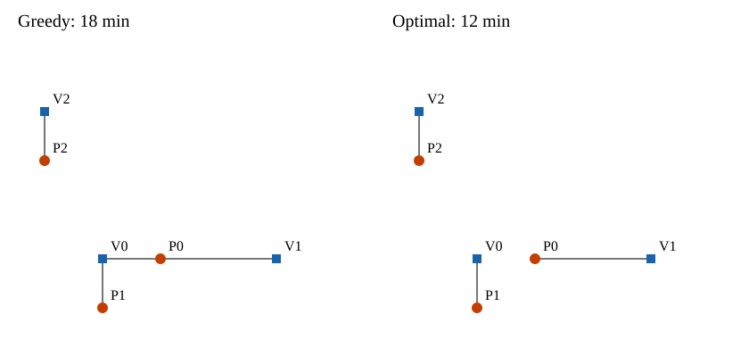

# 10장 배차와 할당 문제

배차는 대기 중인 승객에게 빈 차량을 배정하는 의사결정입니다. 물류에서는 주문을 트럭에 배정하고 배송지를 방문할 순서까지 정합니다. 두 문제 모두 이동 비용을 줄이면서 차량 수와 운행 조건을 지켜야 합니다.

이 장에서는 작은 택시 배차를 손으로 비교한 뒤 최적화 모형으로 표현합니다. 이어서 실제 하남시 OSM 도로망에서 승객 수·차량 수·픽업 시간 상한을 바꾸고, 물류 배송에서는 트럭 적재용량을 바꿔 결과를 읽습니다. 구현은 [10장 실습 노트북][ch10-lab]에서 확인합니다.

## 학습 목표

- 배차의 입력, 결정변수, 목적함수와 제약조건을 구분합니다.
- 탐욕 배차와 전체 비용을 최소화하는 할당을 손으로 비교합니다.
- 총 픽업 시간과 최대 픽업 시간을 줄이는 목적의 차이를 설명합니다.
- 차량 수·시간 상한·적재용량을 바꿔 서비스 인원과 경로를 비교합니다.

## 10.1 비용행렬과 탐욕 배차

승객 3명과 빈 차량 3대가 있습니다. 모두 같은 시각에 요청했으며 목적지까지의 운행은 아직 고려하지 않습니다. 다음 표는 차량에서 승객까지 이동하는 픽업 시간입니다. 이 시간에는 요청부터 배차 확정까지의 지연이 포함되지 않습니다.

| 픽업 시간(분) | 차량 V0 | 차량 V1 | 차량 V2 |
|---|---|---|---|
| 승객 P0 | 3 | 6 | 15 |
| 승객 P1 | 3 | 12 | 15 |
| 승객 P2 | 9 | 18 | 3 |

표는 교재 자체 가상 격자에서 계산했습니다. 차량 좌표는 V0=(1,1), V1=(4,1), V2=(0,4)km입니다. 승객 좌표는 P0=(2,1), P1=(1,0), P2=(0,3)km입니다. 가로·세로 이동거리의 합을 시속 20km로 이동하므로 1km에 3분입니다.

P0부터 처리하면 가장 가까운 V0를 받습니다. P1에게는 V1과 V2가 남아 있으므로 12분 걸리는 V1을 줍니다. P2는 V2를 받아 3분을 기다립니다. 총 픽업 시간은 3+12+3=18분입니다. 먼저 처리하는 요청에 남은 차량 중 가장 가까운 차를 주는 방법을 **탐욕 배차**라고 합니다.

그런데 P0가 V1을 받으면 어떨까요? P0는 6분, P1은 V0를 받아 3분, P2는 V2를 받아 3분을 기다립니다. 총 12분으로 줄어듭니다. P0가 3분 더 기다리는 대신 P1이 9분 덜 기다립니다.

그림 10.1. 사각형 V는 차량, 원 P는 승객입니다. 같은 입력에서 P0와 P1에게 보낼 차량을 바꾸면 총 픽업 시간이 18분에서 12분으로 줄어듭니다. 선은 가로·세로 최단경로 한 가지를 표시합니다.

각 승객의 최근접 차량을 따로 선택하면 P0와 P1이 모두 V0를 고릅니다. 같은 시각에 차량 한 대가 두 승객을 각각 태우러 갈 수 없으므로, 한 사람의 선택이 다른 사람의 선택을 제한합니다.

## 10.2 최적화 모형의 네 요소

**최적화(optimization)**는 허용된 선택 중에서 정한 기준에 가장 좋은 선택을 찾는 일입니다. 택시 예제에서는 주어진 픽업 시간을 바탕으로 차량 배정을 바꿉니다.

| 요소 | 택시 배차에서의 의미 | 작은 예제 |
|---|---|---|
| 입력 | 선택하기 전에 주어진 값 | 승객 3명, 차량 3대, 픽업 시간표 |
| 결정변수 | 계산으로 정할 선택 | P0에게 V0를 보낼지 여부 |
| 목적함수 | 줄이거나 늘릴 평가값 | 세 승객의 픽업 시간 합 |
| 제약조건 | 허용되는 선택의 조건 | 승객당 한 대, 차량당 최대 한 명 |

승객을 i, 차량을 j로 표시합니다. 입력 cᵢⱼ는 차량 j가 승객 i에게 가는 시간입니다. 결정변수 xᵢⱼ는 배차하면 1, 배차하지 않으면 0입니다. 승객 수가 차량 수 이하이고 모든 승객에게 배차할 수 있다고 가정하면 다음과 같이 씁니다.

$$
\min_x \sum_i\sum_j c_{ij}x_{ij}
$$

$$
\sum_j x_{ij}=1\quad(\text{모든 승객 }i),\qquad
\sum_i x_{ij}\leq 1\quad(\text{모든 차량 }j),\qquad
x_{ij}\in\{0,1\}.
$$

목적함수의 각 항은 선택한 차량의 픽업 시간만 더합니다. 첫 제약은 각 승객에게 정확히 한 대를 보내고, 둘째 제약은 같은 차량을 중복 배차하지 못하게 합니다. 0과 1만 허용하므로 차량 반 대를 배차하는 해도 배제합니다.

실행 가능한 해(feasible solution)는 제약조건을 모두 만족하는 배정입니다. 앞 절의 18분과 12분 배정은 둘 다 실행 가능합니다. 그중 목적함수가 가장 작은 해가 최적해입니다. 이 3명 예제의 일대일 배정 6가지를 모두 조사하면 최솟값은 12분입니다.

최적이라는 말에는 입력과 목적이 따라붙습니다. 이 결과는 주어진 픽업 시간의 합에 대한 최적해입니다. 실제 통행시간이 다르거나 목적지 운행까지 고려하면 같은 배정이 최선이라는 보장은 없습니다.

## 10.3 미배차와 픽업 시간 상한

승객 12명에 빈 차량이 6대라면 모든 승객에게 즉시 한 대씩 보낼 수 없습니다. 앞 절의 승객별 등식을 그대로 쓰면 실행 가능한 해가 없습니다. 미배차 여부를 결정변수로 추가합니다.

미배차이면 1인 변수 uᵢ를 추가합니다. 승객 i에게 차량을 보내거나 미배차로 남기는 두 선택 중 하나를 고릅니다.

$$
\sum_j x_{ij}+u_i=1,\qquad u_i\in\{0,1\}.
$$

픽업 시간 상한을 L분으로 정하면 L분보다 먼 차량은 후보에서 제외합니다.

$$
c_{ij}>L\ \Longrightarrow\ x_{ij}=0.
$$

목적을 시간 합 최소화 하나로만 두면 아무도 배차하지 않는 선택의 비용이 0이 됩니다. 이 장에서는 목적의 우선순위를 정합니다. 먼저 미배차 인원을 최소화하고, 그 인원을 유지하는 배정 중 총 픽업 시간을 최소화합니다.

$$
\text{1순위: }\min\sum_i u_i,\qquad
\text{2순위: }\min\sum_i\sum_j c_{ij}x_{ij}.
$$

차량 수가 충분해도 시간 상한 안에 도달할 차량이 없으면 해당 승객은 미배차입니다. 미배차는 이 한 시점의 결정이며 서비스 전체에서 영구히 거절했다는 뜻은 아닙니다. 11장에서는 다음 시점까지 대기한 요청을 다시 배차합니다.

## 10.4 총 픽업 시간과 최대 픽업 시간

총 픽업 시간은 모든 배차 승객의 시간을 더합니다. 최대 픽업 시간은 그중 가장 오래 기다리는 한 사람의 시간입니다. 둘은 서로 다른 평가 기준입니다.

최대 시간을 줄이려면 상한을 나타내는 변수 T를 도입합니다. 배차한 모든 쌍의 시간이 T 이하가 되도록 하고 T를 최소화합니다. 미배차 인원을 먼저 최소화하는 조건은 유지합니다.

$$
\min T,\qquad c_{ij}x_{ij}\leq T\quad(\text{모든 }i,j),\qquad T\geq0.
$$

총시간 최소 배정에서 일부 승객만 오래 기다린다면 최대시간 목적을 검토할 수 있습니다. 최대시간을 줄이는 과정에서 총시간은 늘어날 수 있습니다. 어느 목적이 적합한지는 평균적인 비용 절감과 긴 대기 완화 중 어떤 서비스 기준을 택하는지에 달렸습니다.

비교할 때는 같은 승객·차량·픽업 상한을 유지합니다. 두 모형이 같은 수의 승객을 배차하는지도 확인합니다. 배차된 승객의 구성이 달라질 수 있으므로 승객별 배정표도 함께 읽습니다.

## 10.5 하남시 OSM 도로망 비교

[하남시 배차·배송 지도 HTML](../_static/ch10_optimization.html)을 엽니다. 승객 최대 12명과 차량 최대 16대의 배차를 비교합니다. 도로는 저장소의 하남시 OSM 자동차 도로망이며 승객과 차량 위치는 난수 시드 42로 만든 가상 표본입니다. 실제 택시 호출이나 운행 이력은 아닙니다.

차량에서 승객으로 가는 방향을 따라 도로 최단 통행시간을 계산합니다. 도로의 방향성을 반영하므로 반대 방향 시간과 같지 않을 수 있습니다. 모든 도로의 속도는 시속 30km로 둡니다. 회전 금지, 혼잡과 승하차 가능 여부는 생략합니다.

지도는 배정된 차량과 승객을 도로 형상에 따라 연결합니다. 화면에서 다음 조건을 하나씩 바꾸면 목적함수와 제약조건 표시도 함께 달라집니다.

| 비교 | 고정 조건 | 바꿀 조건 | 함께 읽을 결과 |
|---|---|---|---|
| 공급 부족 | 승객 12명, 상한 10분, 총시간 목적 | 차량 12대 → 6대 | 서비스 인원, 평균·최대 픽업 시간 |
| 도달 가능 범위 | 승객 12명, 차량 12대, 총시간 목적 | 상한 10분 → 3분 | 미배차 수와 위치 |
| 서비스 기준 | 승객 12명, 차량 12대, 상한 10분 | 총시간 → 최대시간 목적 | 총·최대 시간과 승객별 배정 |
| 처리 규칙 | 동일한 승객·차량·상한 | 최적 할당 → 탐욕 배차 | 서비스 인원과 총시간 |

평균과 최대 픽업 시간은 배차된 승객만 대상으로 계산합니다. 차량을 줄이거나 시간 상한을 좁혔는데 평균이 줄었다면, 먼 승객이 미배차로 빠진 것인지 먼저 확인합니다. 탐욕 배차는 먼저 고른 차량 때문에 나중 승객의 후보가 사라져 서비스 인원도 줄어들 수 있습니다.

승객 12명을 고정한 지도 예제의 계산 결과는 다음과 같습니다. 시간은 분이며 소수 첫째 자리로 반올림했습니다.

| 조건 | 서비스 인원 | 총 픽업 | 평균 픽업 | 최대 픽업 |
|---|---|---|---|---|
| 차량 12대, 상한 10분, 총시간 최소 | 12명 | 32.0 | 2.7 | 5.6 |
| 차량 6대, 상한 10분, 총시간 최소 | 6명 | 14.7 | 2.4 | 4.3 |
| 차량 12대, 상한 3분, 총시간 최소 | 9명 | 16.1 | 1.8 | 2.8 |
| 차량 12대, 상한 10분, 최대시간 최소 | 12명 | 34.4 | 2.9 | 5.1 |

차량 6대의 평균 2.4분은 12대의 2.7분보다 작지만 절반이 배차받지 못했습니다. 최대시간 목적은 전원 배차를 유지하면서 최대 픽업을 5.6분에서 5.1분으로 줄입니다. 그 대신 총 픽업은 32.0분에서 34.4분으로 늘어납니다.

9장의 ETA 모형으로 비용행렬을 채울 수도 있습니다. 예측 시간으로 배정한 뒤에는 같은 도로망 시간으로 다시 평가해야 비용 추정 방법을 공정하게 비교할 수 있습니다. 예측값이 작다는 사실만으로 실제 픽업도 짧다고 판단하지 않습니다.

## 10.6 트럭의 용량 제약과 방문 순서

택시는 이 시점에 승객 한 명과 차량 한 대를 짝지었습니다. 배송 트럭은 여러 주문을 싣고 여러 배송지를 방문합니다. 주문을 어느 트럭에 실을지와 어떤 순서로 배송할지를 함께 정합니다.

차량 한 대가 모든 지점을 방문하고 출발지로 돌아오는 순서를 정하면 외판원 문제(TSP, traveling salesperson problem)입니다. 여러 대에 방문지를 나누고 경로를 정하면 차량경로 문제(VRP, vehicle routing problem)입니다. 각 트럭의 적재용량까지 제한하면 용량 제약 차량경로 문제(CVRP, capacitated vehicle routing problem)가 됩니다.

지도 HTML의 트럭 배송 화면은 중앙 차고지 D와 주변 배송지 12곳을 사용합니다. 배송 수량은 2, 2, 3, 2, 3, 2상자를 두 번 반복한 총 28상자입니다. 차고지와 주문 위치는 실제 OSM 도로 노드에 배치한 가상 입력입니다.

운행 트럭 수는 2~6대, 트럭당 적재 한도는 7·10·15상자로 바꿀 수 있습니다. 선택한 트럭은 모두 배송지를 1곳 이상 맡고 D에서 출발해 복귀합니다. 주문은 나누지 않으며 중간 재적재도 하지 않습니다.

배송지 i를 트럭 k에 배정하면 zᵢₖ=1, 주문 수량을 qᵢ, 트럭 용량을 Qₖ로 표시합니다. 용량 제약은 다음과 같습니다.

$$
\sum_i q_i z_{ik}\leq Q_k\quad(\text{모든 트럭 }k).
$$

각 배송지는 정확히 한 트럭에 배정합니다. 총 적재용량은 주문 28상자 이상이어야 합니다. 대당 10상자 트럭 2대로는 배송할 수 없으므로 화면에 용량 부족을 표시합니다. 다만 총량 조건만 맞는다고 주문을 트럭별로 나눌 수 있는 것은 아닙니다. 예를 들어 4상자 주문 3건은 용량 6상자 트럭 2대에 분할 없이 실을 수 없습니다.

트럭 k가 i 다음 j를 방문하면 yᵢⱼₖ=1로 둡니다. 도로 거리 dᵢⱼ로 계산한 트럭별 거리를 Dₖ라고 하면, 총 주행거리 목적은 다음과 같습니다.

$$
 D_k=\sum_i\sum_j d_{ij}y_{ijk},\qquad\min\sum_k D_k.
$$

마지막 트럭이 돌아오는 시각을 앞당기려면 가장 긴 경로를 줄이는 목적을 선택합니다. 최장 거리를 L로 두면 다음과 같이 표현합니다.

$$
\min L,\qquad D_k\leq L\quad(\text{모든 트럭 }k).
$$

모든 트럭이 같은 시각에 같은 속도로 출발하고 배송 작업시간을 생략하면, 최장 거리가 짧을수록 마지막 복귀가 빨라집니다. 최장 거리가 같은 해에서는 총거리가 더 짧은 해를 선택합니다.

방문 순서를 표현하려면 용량식 외에도 각 배송지를 한 번 방문하는 조건, 도착한 뒤 다음 지점으로 출발하는 조건이 필요합니다. D와 연결되지 않은 작은 순환만 생기지 않도록 경로 연결도 보장해야 합니다.

| 운행 트럭 | 트럭당 용량 | 목적함수 | 총거리 | 최장 경로 |
|---|---|---|---|---|
| 3대 | 10상자 | 총 주행거리 최소 | 23.332km | 8.859km |
| 4대 | 10상자 | 총 주행거리 최소 | 25.672km | 8.859km |
| 4대 | 10상자 | 최장 경로 최소 | 31.491km | 8.190km |
| 6대 | 10상자 | 최장 경로 최소 | 38.930km | 7.820km |

표는 같은 주문 28상자와 도로망에서 동적계획법으로 계산한 최적해입니다. 트럭 4대에서 목적함수만 바꾸면 최장 경로는 669m 짧아지고 총거리는 5.819km 늘어납니다. 트럭을 늘리면 주문을 더 나눌 수 있지만, 모든 트럭이 운행하므로 차고지 왕복도 늘어납니다.

거리는 OSM 엣지 길이를 합산해 지점 사이 구간별 m 정수로 반올림했습니다. [입력·계산 결과](../_static/ch10_city.json)의 `fleet` 항목에 가상 배치, 도로 노드, 경로와 목적별 결과를 저장했습니다. 가상 격자 예제는 별도의 [검산 자료](../_static/ch10_optimization.json)에 있습니다.

동적계획법은 배송지 부분집합별 최단 순회를 구한 뒤, 이를 운행 트럭 수만큼 나누는 모든 분할을 비교합니다. 이 예제의 배송지 12곳에 한정한 검산 방법입니다. 지도에서 `OR-Tools` 탐색 결과로 전환하면 제한 시간 안에 찾은 해와 최적해를 비교할 수 있습니다.

## 10.7 해법의 선택과 시뮬레이션 연결

승객 3명과 차량 3대의 일대일 배정은 6가지입니다. 같은 수가 20으로 늘면 20!가지이므로 가능한 배정을 모두 나열하는 방법은 곧 한계에 도달합니다. 일대일 할당은 구조를 이용하는 전용 알고리즘으로 더 큰 입력도 풀 수 있습니다.

[실습 노트북][ch10-lab]은 탐욕 배차와 `SciPy` 할당 함수를 비교합니다. 흔히 헝가리안 알고리즘을 소개할 때 쓰는 문제이지만, 현재 `SciPy` 구현은 수정 Jonker–Volgenant 알고리즘입니다. 직사각 행렬과 반환값은 아래 자료에서 확인합니다.

[SciPy 할당 함수 문서](https://docs.scipy.org/doc/scipy/reference/generated/scipy.optimize.linear_sum_assignment.html)

지도 HTML의 택시는 최소비용 흐름으로 배차 인원을 먼저 최대화하고 시간 합을 줄입니다. 최대시간 목적에서는 허용 가능한 시간 상한을 좁히며 같은 배차 인원을 유지할 수 있는지 검사합니다. 화면에서 설정을 바꿀 때 택시 배정은 브라우저에서 다시 계산합니다.

`OR-Tools`는 최적화 문제를 푸는 도구 모음입니다. 0과 1로 배차 여부를 정하고 논리 조건을 추가하려면 `CP-SAT`으로 표현할 수 있습니다. 여러 차량의 방문 순서와 적재용량을 다루는 예제에는 라우팅 솔버를 사용합니다. 사용하는 도구가 같아도 두 문제의 결정변수와 제약조건은 다릅니다.

**휴리스틱(heuristic)**은 실행 가능한 해를 만들고 개선하는 탐색 방법입니다. 최근접 이웃이나 경로 구간을 뒤집는 2-opt가 예입니다. 배송 문제는 입력이 커지면 제한된 시간 안에 찾은 해를 사용할 수 있습니다. 실행 가능한 해를 얻었다는 사실과 최적성을 증명했다는 사실을 구분합니다.

실행시간은 알고리즘 이름 외에도 입력 크기, 구현, 후보 수와 시간 제한에 따라 달라집니다. 작은 입력 한 번의 결과로 특정 규모부터 항상 더 빠르다고 단정하지 않습니다.

이 장의 배차는 한 시점에 주어진 요청과 빈 차량을 대상으로 합니다. 11장에서는 새 요청을 추가하고, 배차 뒤 픽업 이동·승하차·목적지 이동을 반영해 다음 가용 시각을 갱신합니다. 한 시점의 픽업 시간을 최소화해도 이후 수요까지 포함한 하루 운영의 최적해가 되지는 않습니다.

## 정리

- 최적화 모형은 입력·결정변수·목적함수·제약조건으로 설명합니다.
- 택시 할당에서는 차량 중복 사용을 막고, 미배차 인원을 먼저 줄인 뒤 픽업 시간을 줄입니다.
- 총시간과 최대시간 목적을 비교할 때 서비스 인원과 승객별 결과를 함께 읽습니다.
- 트럭 배송은 주문 배정에 더해 적재용량과 연결된 방문 순서를 다룹니다.
- 11장에서는 한 시점의 배차를 시간축 위에서 반복하고 차량 상태를 갱신합니다.

## 연습문제

### 연습 10.1 배차 조건 변경과 지도 시각화 ★★

[배차 지도](../_static/ch10_optimization.html)의 동일한 승객 12명을 사용해 봅시다. 기준 조건은 차량 12대, 픽업 상한 10분, 총 픽업 시간 최소화입니다. 차량만 6대로 줄인 안, 상한만 3분으로 줄인 안, 목적만 최대시간 최소화로 바꾼 안을 각각 기준과 비교해 봅시다.

산출물은 기준을 포함한 4행 비교표와 지도 이미지 2장입니다. 표에는 차량 수, 픽업 상한, 목적, 서비스 인원, 총·평균·최대 픽업 시간을 넣어 봅시다. 지도에는 승객·차량 번호와 미배차 표시가 보이도록 해 봅시다. 각 안이 바꾼 목적함수 또는 제약조건과 결과의 이유를 5문장 이내로 설명해 봅시다.

## 10.8 OR-Tools 실습

[OR-Tools 공식 예제](https://developers.google.com/optimization/examples?hl=ko)를 엽니다. 문제 유형을 라우팅으로 좁히고, 「용량 제약이 있는 차량 라우팅 문제」 하나를 골라 봅시다. 연결된 Python 예제나 Colab에서 기본 결과를 확인합니다. [용량 제약 튜토리얼](https://developers.google.com/optimization/routing/cvrp?hl=ko)도 참고합니다.

먼저 예제의 거리 행렬, 배송 수량, 차량 수와 적재용량을 찾아 이 장의 dᵢⱼ, qᵢ, Qₖ에 대응시켜 봅시다. 배송 수량은 유지하고 모든 차량의 적재용량만 늘린 뒤 다시 풀어 봅시다. 방문 순서가 같아도 제약조건을 완화했는데 개선이 없는 이유를 설명할 수 있습니다.

산출물은 기본안과 변경안의 2행 비교표, 차량별 방문 순서·출발 적재량, 경로 그림 1장입니다. 공식 예제 좌표를 쓰면 좌표 단위를 밝히고, 거리 행렬만 있으면 방문 순서 연결도로 표현해 봅시다. 추상 예제 좌표를 실제 도시 지도 위에 표시하지 않습니다. 모형의 목적과 용량 제약을 각각 한 문장으로 설명하고, 출력 상태가 최적성까지 보장하는지도 확인해 봅시다.

[ch10-lab]: https://github.com/jihoyeo/mobility-simulation-book/blob/main/labs/ch10_dispatch.ipynb
